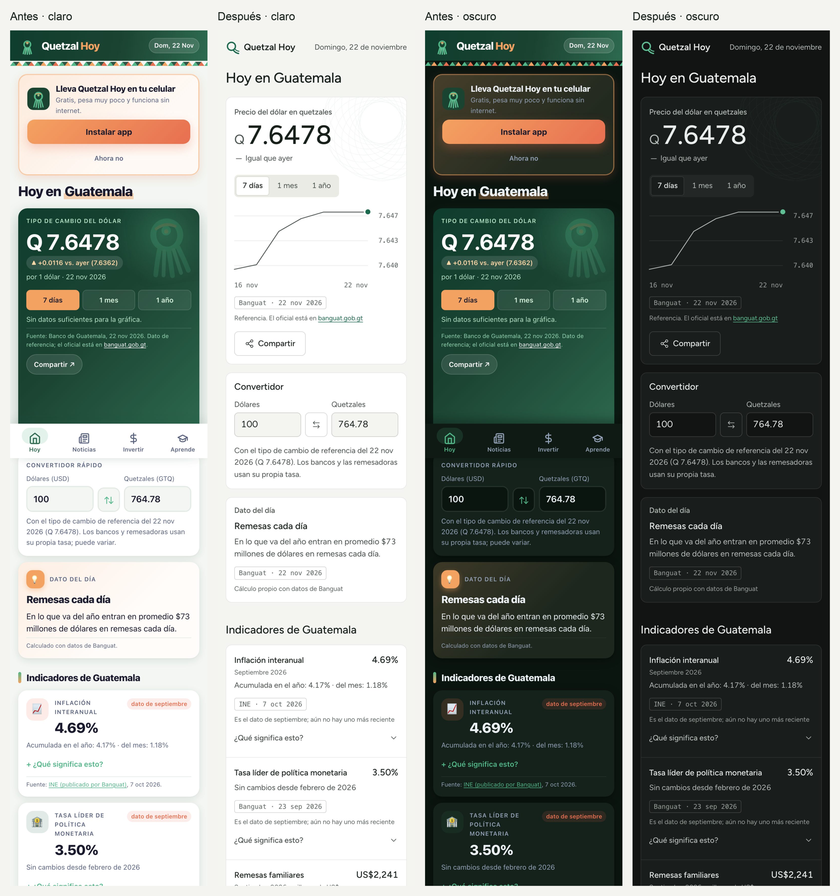

# Fase U — Rediseño con Unslop

- `UNSLOP.md` — las instrucciones aprobadas de la fase.
- `auditoria.md` — lo que se veía hecho por IA antes del rediseño (nivel Fuerte).
- `antes/` — capturas de todas las pantallas antes (390 px claro y oscuro, Hoy a 1280 px, imagen del día,
  og-image e ícono).
- `despues/` — las mismas pantallas después, tomadas del sitio publicado (hoy.compoundclub.fyi).
- `antes-despues.png` — Hoy lado a lado. No hay video: esta Mac no tiene Playwright ni ffmpeg.
- Reglas de diseño que quedan para las próximas fases: [`DISENO.md`](../../DISENO.md).

## Lo de la auditoría, punto por punto

| Grupo | Antes | Después |
|---|---|---|
| Superficies y color | Degradados en cabecera, botones, portadas y barras; mancha radial; sombras de color; fondo teñido de verde; cinco colores a la vez; dólar en verde/naranja | Papel grafito neutro y un solo acento verde; sin degradados, brillos ni sombras de color; el dólar sube o baja en gris con flecha y palabras |
| Tipografía | Pesos 800, etiquetas en MAYÚSCULAS, textos de 10–12 px, cifras sin tabular, fuente del sistema | Figtree 400–600 autoalojada, tipo oración, nada menor de 13 px, números tabulares en toda la app |
| Íconos | Emojis en indicadores, noticias, cursos, 404, sin conexión, WhatsApp; logo de dos colores | Íconos de línea (Lucide, trazo 1.5): 22 px en la barra, 18 px en lo demás; cero emojis; logo de un color |
| Espaciado | Valores sueltos (6, 10, 14, 18 px), rellenos distintos, franja vacía de 470 px en la tarjeta del dólar | Escala de 4; mismas tarjetas con el mismo relleno; la tarjeta del dólar mide lo que su contenido |
| Textos | Puntos finales en etiquetas, "vs. ayer" sin palabras, tres frases sin comprobar, "Resumen automático" como pastilla | Sin puntos en etiquetas, "Q 0.0116 más que ayer", frases sin comprobar quitadas, "Resumen automático" discreto |
| Componentes | Pastillas por todos lados, badges de colores, fuente y fecha distinta en cada lugar | Un solo componente para fuente y fecha: el sello `Banguat · 22 nov 2026` |
| Visuales | Tejido, quetzal de marca de agua, portadas de colores | Solo dos momentos: la gráfica del dólar (con guilloché muy tenue) y las gráficas de calculadoras |
| Movimiento | Escalas al pasar el mouse, tiempos distintos, spinner girando | Una curva, 150 ms de respuesta y 360 ms de entrada; respeta "reducir movimiento" |
| Layout | Tira de 600 px en computadora, barra estirada | Hoy e Invertir a dos columnas hasta 1120 px, pestañas en la cabecera |

## Checklist de la skill (al cierre)

- [x] Dirección escrita y seguida en cada pasada (`DISENO.md`)
- [x] Espaciado en la escala de 4; cosas iguales con tamaños iguales
- [x] Íconos, etiquetas y números alineados en su columna
- [x] Una rampa neutra, tres roles de texto y un acento con contraste AA (claro y oscuro)
- [x] Sin degradados, texto degradado, brillos, sombras de color ni manchas
- [x] Sin emojis en la interfaz
- [x] Un solo set de íconos con un trazo
- [x] Tipografía elegida por el carácter, pesos 400–600, sin mayúsculas espaciadas, sin cursiva
- [x] Pantallas de derecha a izquierda: no aplica (solo español)
- [x] Sin exclamaciones, sin puntos en textos cortos, sin saludos, sin frases sin comprobar
- [x] Números en un solo formato con cifras tabulares
- [x] Radios anidados coherentes (12 → 8 → 4)
- [x] Tablas: encabezado, valores y foco se distinguen
- [x] Botones con el mismo radio de control
- [x] La primera pantalla tiene un momento real (la tarjeta del dólar), sin relleno
- [x] Primera pantalla sin franjas vacías; la tarjeta del dólar reserva su lugar mientras carga
- [x] Sin movimiento en bucle ni rebotes; una curva; sin animar alto, ancho ni posición
- [x] Prueba de plantilla: con otro nombre la pantalla no encaja (precio del dólar en quetzales, sello del
  Banguat, la Q con cola de quetzal, el guilloché de billete)

Rediseño guiado por unslop de Damir Sokolovsky (@heydamir), CC BY 4.0.
